# API e cache — o que foi feito e porquê

Este documento explica, por ordem, como o FMData passou a falar com a API e a guardar os dados no browser.
A ideia é que consigas ler o código com o documento ao lado e perceber **cada decisão**, não só o resultado.

---

## 1. O problema que isto resolve

Os ecrãs do dashboard precisam de três coisas que a API não dá de graça:

1. **Dados prontos para os componentes** — a API devolve JSON com nomes em `snake_case` (`track_name`, `date_uts`) e datas em segundos. Ninguém quer tratar disso dentro de um componente.
2. **Cache** — a API está em hospedagem gratuita e pode demorar dezenas de segundos a acordar. Sem cache, cada visita ao dashboard paga esse preço.
3. **Uma fonte de verdade** — o período escolhido no filtro e os dados carregados têm de estar no mesmo sítio, para dois componentes não fazerem o mesmo pedido.

A solução tem três camadas, cada uma com uma responsabilidade:

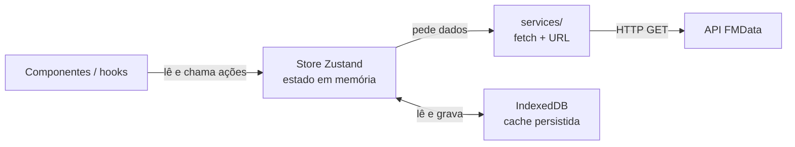

Regra prática:

| Camada | Só faz isto | Nunca faz isto |
|---|---|---|
| `services/` | monta o URL, faz o `fetch`, devolve um resultado | não guarda estado, não decide o que mostrar |
| `stores/` | guarda dados, estados e ações; conversa com a cache | não sabe construir URLs nem interpretar HTML |
| `hooks/` | liga componentes à store e à hidratação | não faz `fetch` diretamente |

---

## 2. Passo 1 — Conhecer a API antes de escrever código

Antes de criar ficheiros, a API foi lida no `openapi.json` e testada à mão. Factos que mudaram o desenho:

| Facto | Consequência no código |
|---|---|
| `/scrobbles` devolve o histórico completo — **26 MB**, 58 s a frio | durante o desenvolvimento usamos `/scrobbles/amostra` (100 registos) |
| `date_uts` está em **segundos** | quem converter para `Date` tem de multiplicar por 1000 (etapa das funções puras) |
| `date_iso` e `date_uts` são `null` em `nowplaying` | os filtros por data têm de aceitar `null` |
| Erros vêm como `{ error: { code, message } }` | a camada HTTP lê esse corpo em vez de inventar texto |
| Nomes com acentos, `&`, apóstrofos (`Jão`, `Haute & Freddy`) | a query é construída com `URLSearchParams`, que codifica sozinho |
| `/artist-info` e `/album-info` dão 404 quando não existem | 404 vira `status: "not-found"`, não `"error"` |

O endpoint atual vive numa **única constante**:

```ts
// src/services/scrobbles.ts
export const SCROBBLES_ENDPOINT = "/scrobbles/amostra";
```

Nada no resto do projeto sabe que o endpoint é a amostra. Trocar para o histórico completo é mudar esta linha.

---

## 3. Passo 2 — Tipos separados por responsabilidade

`src/types/` não é um ficheiro gigante nem um `types.d.ts` global. Cada ficheiro responde a uma pergunta diferente:

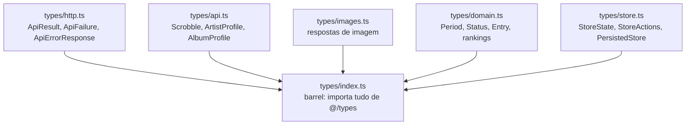

**Porquê módulos e não tipos globais?** Um `.d.ts` com `export` continua a ser um módulo. Para ficar global teria de usar `declare global`, e nomes genéricos como `Status` ou `Entry` passariam a colidir com bibliotecas. Com import explícito (`import type { Entry } from "@/types"`) percebe-se sempre de onde vem cada contrato.

### O tipo central: `Entry<T>`

```ts
export interface Entry<T> {
  data: T | null;
  status: Status;
  error: string | null;
  updatedAt: number | null;
}
```

Uma `Entry` descreve **qualquer** dado remoto. `Entry<Scrobble[]>`, `Entry<ArtistProfile>` e `Entry<AlbumProfile>` funcionam todos com o mesmo código.

### O resultado de um pedido

```ts
export type ApiResult<T> = ApiSuccess<T> | ApiFailure;

export interface ApiSuccess<T> { ok: true; data: T; }
export interface ApiFailure {
  ok: false;
  status: number;              // 0 = rede/cancelado
  code: ApiErrorCode | null;   // "not_found" | "missing_parameter" | null
  message: string;
}
```

Isto é uma **união discriminada**: o campo `ok` diz ao TypeScript qual dos dois casos está ali. Depois de `if (!result.ok)`, o compilador sabe que existe `message`; depois de `if (result.ok)`, sabe que existe `data`.

**Por que não lançar exceções nem criar uma classe `ApiError`?** Porque quem chama seria obrigado a usar `try/catch` em todo o lado, e uma exceção é fácil de esquecer. Com um objeto de resultado, a falha é um valor normal: aparece no tipo de retorno e o editor obriga-te a tratá-la. Também cumpre a regra do projeto: sem programação orientada a objetos.

---

## 4. Passo 3 — Uma camada HTTP que nunca rebenta

`src/services/http.ts` é o único ficheiro que conhece o URL base, a query e os erros.

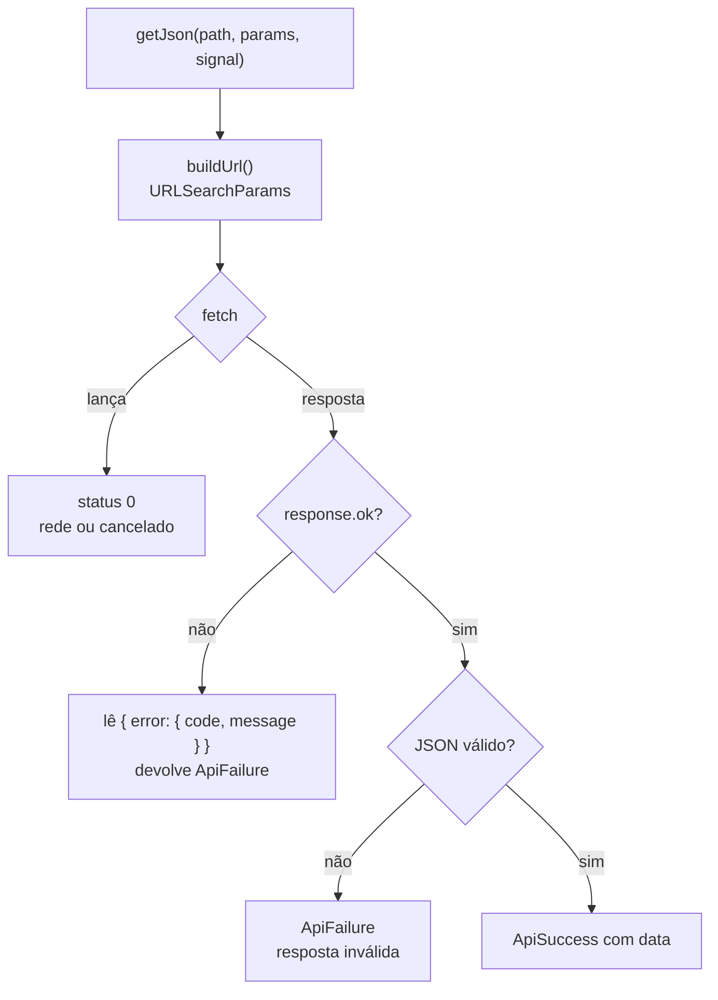

Três decisões importantes:

1. **`buildUrl` é uma função separada.** Constrói o URL e ignora parâmetros `undefined`, `null` ou `""`. Adicionar um parâmetro no futuro é uma linha num objeto; a query continua correta e codificada.
2. **`cache: "no-store"`.** Queremos controlar a cache nós próprios; o browser não deve servir respostas antigas.
3. **Erros de parâmetro acontecem antes do `fetch`.** `getArtistInfo("   ")` devolve `missing_parameter` sem gastar um pedido à API.

Snippet real de uma função de endpoint:

```ts
export async function getAlbumInfo(artist: string, album: string, signal?: AbortSignal) {
  const artistName = artist.trim();
  const albumName = album.trim();
  if (!artistName) return missingParameter("artist");
  if (!albumName) return missingParameter("album");

  return getJson<AlbumProfile>(
    "/album-info",
    { artist: artistName, album: albumName },
    signal,
  );
}
```

O `signal` permite cancelar o pedido mais tarde, sem mudar a assinatura.

---

## 5. Passo 4 — Um ficheiro por família de endpoints

`services/api.ts` tinha ~200 linhas e misturava scrobbles, perfis, imagens e estatísticas. Foi dividido para que cada ficheiro caiba na cabeça de quem lê:

| Ficheiro | Exporta |
|---|---|
| `http.ts` | `API_URL`, `buildUrl`, `getJson`, `failure`, `missingParameter` |
| `scrobbles.ts` | `SCROBBLES_ENDPOINT`, `getScrobbles` |
| `artists.ts` | `getArtistInfo`, `getArtistImage` |
| `albums.ts` | `getAlbumInfo`, `getAlbumImage` |
| `tracks.ts` | `getTrackImage` |
| `stats.ts` | `getListeningClock` |
| `health.ts` | `checkHealth` |

Todas as respostas são tipadas com os contratos de `@/types`. Nenhuma função sabe em que ecrã vai ser usada.

---

## 6. Passo 5 — Guardar em IndexedDB

### Porque não `localStorage`?

| | `localStorage` | IndexedDB |
|---|---|---|
| Limite | ~5 MB por origem | quota grande (disk-based) |
| Escrita | bloqueia a thread | assíncrona |
| Tipos | só texto | texto e estruturas |

A amostra (100 registos, ~51 KB) caberia em qualquer um. O histórico completo (26 MB) **não** cabe em `localStorage`. Como o plano é trocar para o histórico completo, o destino natural é o IndexedDB.

### Como o Zustand guarda lá

O `persist` do Zustand aceita um armazenamento personalizado. O `src/stores/indexed-db-storage.ts` implementa a interface `StateStorage` (três funções assíncronas) por cima do `idb-keyval`:

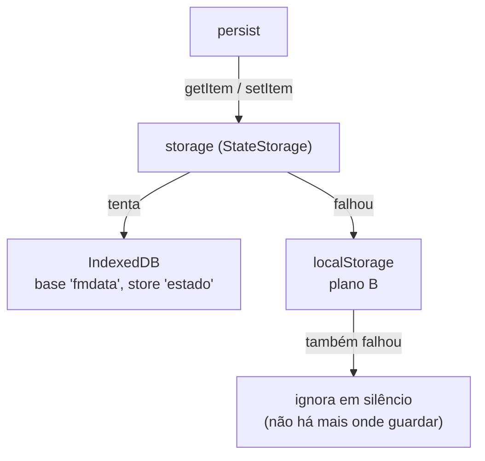

Chave usada: **`fmdata-store:v1`**. O `v1` permite subir a forma dos dados no futuro sem ler caches antigas com o formato errado.

O `idb-keyval` só abre a base de dados no primeiro pedido, por isso criar a loja no topo do módulo é seguro — não corre nada no servidor.

---

## 7. Passo 6 — A store

### Estado e ações

```ts
export interface StoreState {
  period: Period;
  scrobbles: Entry<Scrobble[]>;
  artists: Record<string, Entry<ArtistProfile>>;
  albums: Record<string, Entry<AlbumProfile>>;
}

export interface StoreActions {
  setPeriod: (period: Period) => void;
  loadScrobbles: (force?: boolean) => Promise<void>;
  loadArtist: (name: string, force?: boolean) => Promise<void>;
  loadAlbum: (artist: string, album: string, force?: boolean) => Promise<void>;
}
```

As chaves de `artists` e `albums` são **nomes normalizados** (`normalizeName`: `trim` + minúsculas). Assim `"Adele"` e `"adele "` partilham a mesma entrada e uma só cache.

### Os estados de uma `Entry`

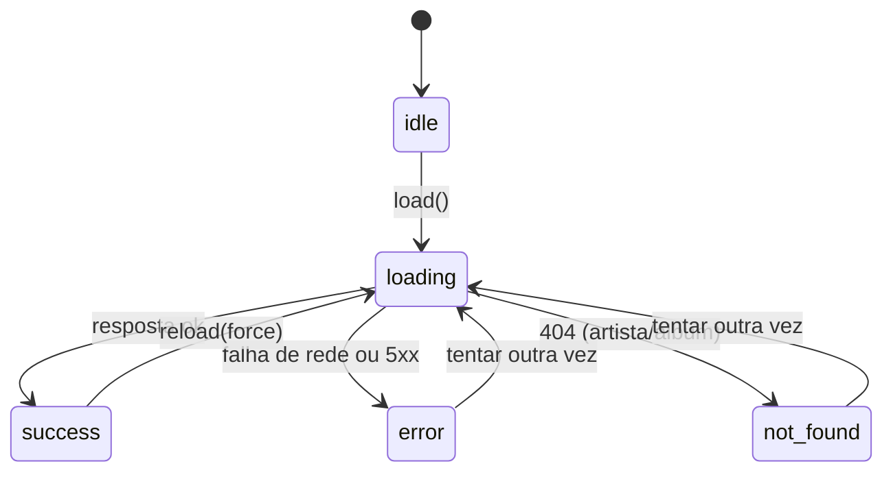

Regras que valem para as três ações:

- Pedir sem `force` quando já há `success` com dados **não faz nada**.
- Durante um `force`, os dados antigos continuam visíveis (`loadingEntry` copia `data` e `updatedAt`).
- Se o pedido falhar, os dados antigos **não são apagados**; só o `status` muda para `error`.
- 404 de artista/álbum vira `not-found` com `error: null` — não é um erro, é uma resposta válida.

### O que vai para a cache

Só dados. Nunca `status`, `loading` ou `error`:

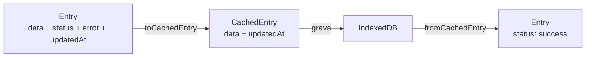

Se o estado `loading` fosse persistido, fechar o separador a meio de um pedido deixaria a app presa em "A carregar" para sempre. Ao reconstruir `status` na leitura, isso não acontece.

### O marcador do endpoint

A cache guarda também `scrobblesEndpoint`. Na junção (`mergePersisted`) compara-se o valor guardado com o atual:

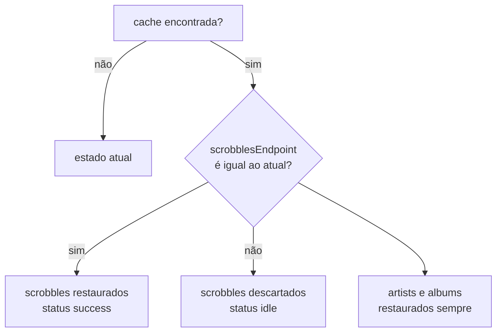

Sem isto, no dia em que trocares a constante para `/scrobbles`, a app mostraria 100 registos como se fossem o histórico completo. Os perfis de artista e álbum não dependem do endpoint dos scrobbles, por isso sobrevivem à troca.

### Deduplicação

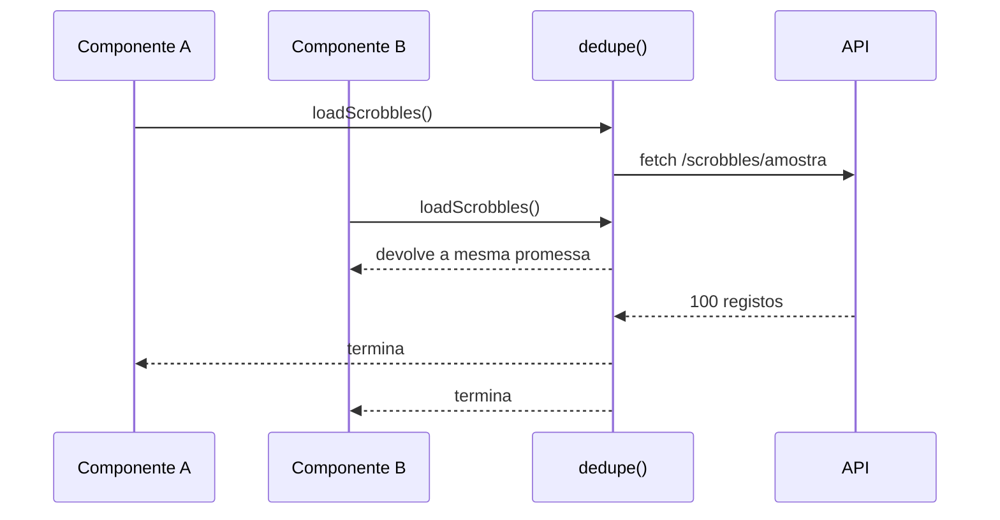

O `Map` de pedidos em curso vive **fora da store** (`src/stores/dedup.ts`): é estado de execução, não estado da aplicação. A chave é `"scrobbles"`, `"artist:<nome>"` ou `"album:<artista>::<álbum>"`. A entrada é apagada no `finally`, mesmo quando o pedido falha.

---

## 8. Passo 7 — Provider com Context, não store global

A store é criada **uma vez por árvore React**, dentro de um provider:

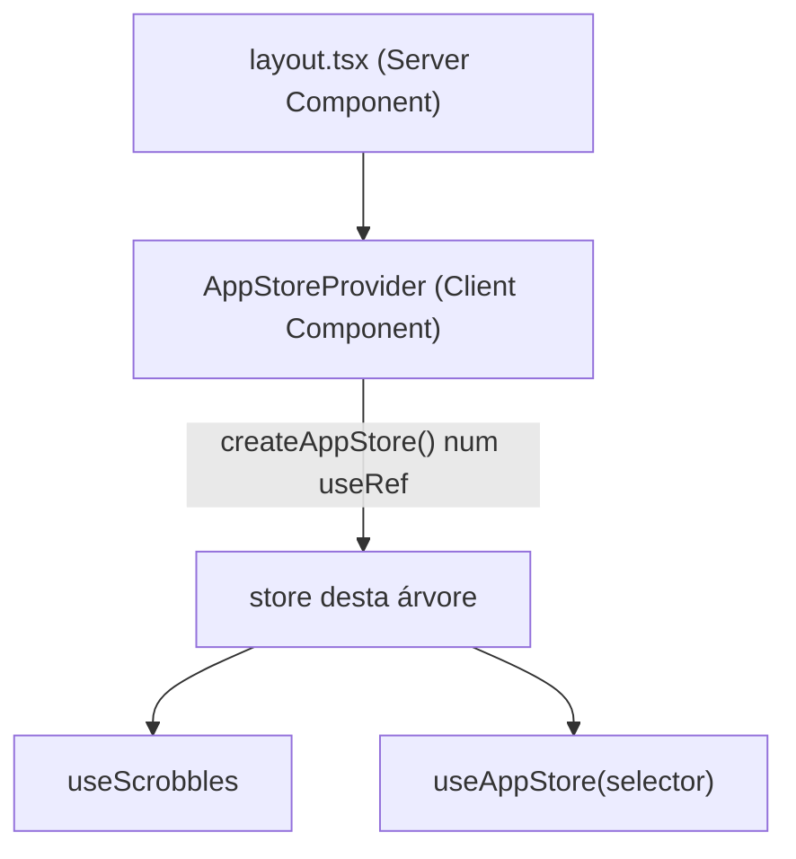

**Porque não `create()` global?** No App Router, um módulo partilhado pelo servidor pode ser reutilizado entre pedidos. Num dashboard pessoal o risco é baixo, mas o padrão Context é o recomendado pela skill `nextjs-zustand` e evita que dados de um pedido apareçam noutro. O custo é um provider no `layout.tsx`.

`useAppStore(selector)` lê uma fatia da store. O selector evita re-renderizações quando outra parte do estado muda.

---

## 9. Passo 8 — Hidratação

O IndexedDB é **assíncrono** e no servidor nem existe. Se o `persist` tentasse reidratar sozinho, o primeiro render do servidor (`status: idle`) e o do cliente (`success` com dados) seriam diferentes — o React avisaria de *hydration mismatch*.

Solução: `skipHydration: true` + reidratar à mão.

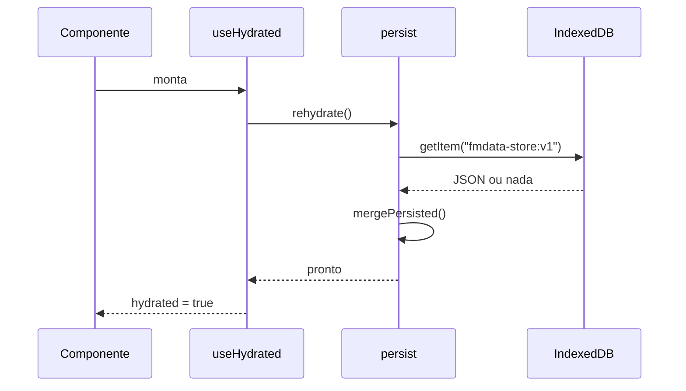

O `useHydrated` guarda a promessa num `WeakMap` por store. Dez componentes a pedir hidratação fazem **uma** leitura. O `active` no `useEffect` evita atualizar estado de um componente já desmontado.

---

## 10. Passo 9 — Hooks

`useScrobbles` é o primeiro consumidor e serve de modelo para os próximos:

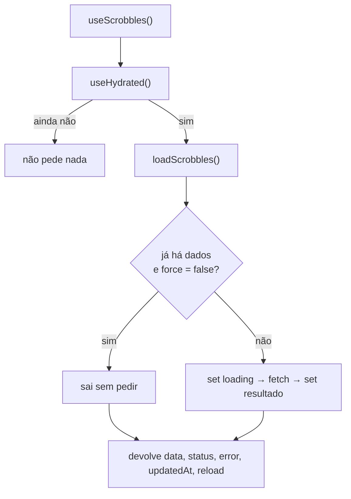

O hook não decide nada sobre cache: chama sempre `loadScrobbles()` depois da hidratação, e é a **ação da store** que verifica se já há dados. Assim a regra vive num só sítio (a store) e o hook fica pequeno.

Duas decisões pequenas mas importantes:

- **Array vazio estável.** `data` devolve sempre a mesma constante `EMPTY_SCROBBLES` quando não há dados. Um `[]` novo a cada render invalidaria os `useMemo` de quem consome.
- **`reload` é `useCallback`.** A referência não muda entre renders, por isso pode ser dependência de efeitos sem causar ciclos.

A store guarda os scrobbles **crus**. Filtros por período, rankings e gráficos ficam na etapa das funções puras; misturar filtro com cache tornaria impossível mudar de período sem novo pedido.

---

## 11. Passo 10 — Verificar

O painel temporário em `src/app/page.tsx` mostra o total, o estado, a hora da cache e a reprodução mais recente. Com ele confirmou-se, no browser:

| Teste | Resultado |
|---|---|
| Primeiro carregamento | 1 pedido a `/scrobbles/amostra`, 100 registos |
| IndexedDB | base `fmdata` → store `estado` → chave `fmdata-store:v1`, ~51 KB |
| Conteúdo gravado | `data` + `updatedAt` (sem `status` nem `error`) |
| Refresh | 0 pedidos; dados restaurados da cache |
| Dois cliques em "Recarregar" | 1 pedido (deduplicação) e `updatedAt` novo |
| `getArtistInfo("Jão")` | `?artist=J%C3%A3o`, resposta ok |
| `getAlbumInfo("Haute & Freddy", "Film Noir")` | `&` codificado como `%26` |
| Artista inexistente | `status 404`, `code: "not_found"` |
| Nome vazio | `400 missing_parameter` sem pedido |
| Consola | sem erros nem avisos de hidratação |
| `npx tsc --noEmit` / `npm run build` | limpos |

### Como repetir a verificação à mão

1. `npm run dev` e abre `http://localhost:3000`.
2. DevTools → **Network**, filtra por `scrobbles`: no primeiro load há um pedido; ao recarregar a página não há nenhum.
3. DevTools → **Application → IndexedDB → fmdata → estado**: a chave `fmdata-store:v1` contém o estado.
4. DevTools → **Console**: não deve haver avisos de hidratação.

---

## 12. Decisões, uma a uma

| Decisão | Porquê | O que se evitou |
|---|---|---|
| `ApiResult` em vez de exceções | a falha passa a ser um valor que o tipo obriga a tratar | `try/catch` espalhado e `instanceof ApiError` |
| Sem classes | regra do projeto; objetos simples chegam | herança, construtores, `this` |
| Um ficheiro por família de endpoints | cada ficheiro lê-se de uma vez | um `api.ts` de 200 linhas |
| IndexedDB em vez de `localStorage` | o histórico completo tem 26 MB | estourar o limite de ~5 MB |
| `StateStorage` próprio | o `persist` não fala IndexedDB sozinho | sincronizar cache à mão em cada ação |
| `skipHydration` + reidratação manual | IndexedDB é assíncrono e não existe no servidor | avisos de hydration mismatch |
| Context em vez de store global | isolar a store por árvore de React | estado partilhado entre pedidos |
| `status` fora da cache | fechar o separador não pode prender o `loading` | "A carregar" eterno |
| Marcador `scrobblesEndpoint` | trocar de endpoint não pode servir dados antigos como novos | amostra exibida como histórico completo |
| Dedup fora da store | é execução, não estado | pedidos repetidos |
| Chaves normalizadas | `"Adele"` e `"adele "` são o mesmo artista | cache duplicada |

---

## 13. Como trocar para o histórico completo

1. Em `src/services/scrobbles.ts`, muda uma linha:

   ```ts
   export const SCROBBLES_ENDPOINT = "/scrobbles";
   ```

2. A cache antiga é ignorada automaticamente (marcador diferente) e o primeiro carregamento trará o histórico completo.

Antes de fazeres isto, lê a secção seguinte.

---

## 14. Limites conhecidos

Estes pontos foram medidos e ficam registados para a próxima etapa:

1. **Escrita de 26 MB a cada `set`.** O `persist` serializa o estado inteiro sempre que a store muda. Com 26 MB, cada atualização de estado custa uma serialização grande. Solução na altura: tirar os scrobbles do `persist` e gravá-los uma vez por pedido bem-sucedido.
2. **Plano B em `localStorage` não serve para 26 MB.** O fallback existe para o IndexedDB falhar; com o histórico completo, o `setItem` do `localStorage` falha em silêncio. O fallback é aceitável enquanto a cache for pequena.
3. **`mergePersisted` não tem teste.** É a função que decide se a cache é usada ou descartada. Um erro aqui mostra dados errados sem aviso. Quando houver runner de testes, três casos bastam: sem cache, mesmo endpoint, endpoint diferente.
4. **Sem timeout nos pedidos.** Se a API aceitar a ligação e não responder, o ecrã fica em "A carregar". O botão "Recarregar" não ajuda, porque a deduplicação devolve o pedido que já está em curso.

---

## 15. Glossário rápido

| Termo | Significado aqui |
|---|---|
| **Store** | objeto que guarda o estado da aplicação e as ações que o mudam |
| **Entry** | envelope `data + status + error + updatedAt` de um dado remoto |
| **União discriminada** | tipo que é "um de vários", distinguido por um campo (`ok`, `status`) |
| **Hidratação** | ler a cache guardada e colocá-la no estado em memória |
| **Deduplicação** | duas chamadas iguais enquanto a primeira corre devolvem a mesma promessa |
| **Query string** | a parte do URL depois de `?`, com os parâmetros codificados |
| **`persist`** | middleware do Zustand que guarda e restaura uma parte do estado |
| **`partialize`** | função que escolhe o que o `persist` grava |
| **`merge`** | função que junta a cache guardada com o estado atual |

---

## 16. Mapa de ficheiros

```text
src/
├── app/
│   ├── layout.tsx                 # envolve a app no AppStoreProvider
│   └── page.tsx                   # painel temporário de verificação
├── services/
│   ├── http.ts                    # base URL, query, fetch, erros
│   ├── scrobbles.ts               # getScrobbles + SCROBBLES_ENDPOINT
│   ├── artists.ts                 # getArtistInfo, getArtistImage
│   ├── albums.ts                  # getAlbumInfo, getAlbumImage
│   ├── tracks.ts                  # getTrackImage
│   ├── stats.ts                   # getListeningClock
│   └── health.ts                  # checkHealth
├── stores/
│   ├── app-store.ts               # estado, ações, opções do persist
│   ├── cache.ts                   # store <-> IndexedDB (partialize/merge)
│   ├── dedup.ts                   # pedidos em curso
│   ├── entry.ts                   # construir Entry a partir do resultado
│   └── indexed-db-storage.ts      # StateStorage + fallback
├── hooks/
│   ├── use-hydrated.ts            # uma reidratação por store
│   └── use-scrobbles.ts           # primeiro consumidor da store
├── providers/
│   └── app-store-provider.tsx     # Context + useAppStore
├── lib/
│   └── filters.ts                 # normalizeName
└── types/
    ├── api.ts                     # dados do Last.fm
    ├── domain.ts                  # Period, Status, Entry, rankings
    ├── http.ts                    # ApiResult e erros
    ├── images.ts                  # respostas de imagem
    ├── store.ts                   # contratos da store e da cache
    └── index.ts                   # barrel de @/types
```

Próximo passo natural: as funções puras (`dates`, `filters`, `stats`, `artist`), que trabalham sobre os scrobbles crus que a store já entrega.
